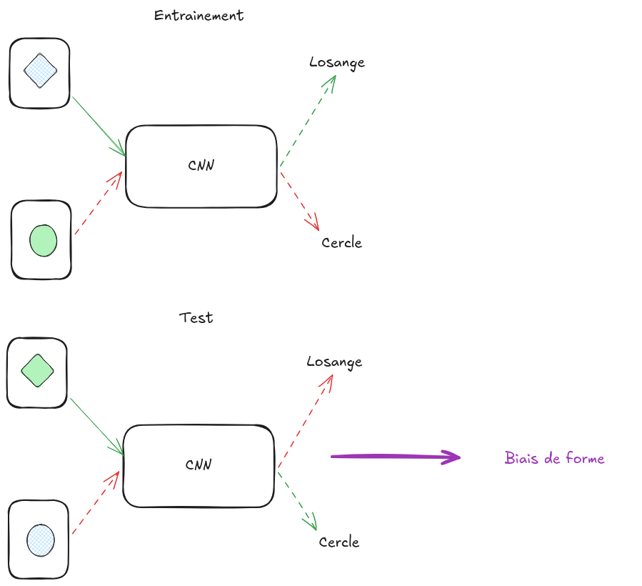

Idée : 

Tester si un cnn classe toujours bien (genre resnet de image net ou autre dataset) après avoir passé l'image dans 
ADAIN-style transfert :

On va prendre un chat et lui appliquer la texture d'un elephant pour voir si le modele le classe toujours comme chat ou pas

(Pour ADA IN voir comment le réimplémenter c'est un VGG)

Idéé 2 :
Faire le lien avec les ondellettes et montrer que les ondelletes on un biais de texture

Comparer avec des Vit ou des architecture plus SOTA

Idée 3:

Afficher les cartes de chaleur des Convolution sur les images pour vori quels sont le zones activé par les CNN.

